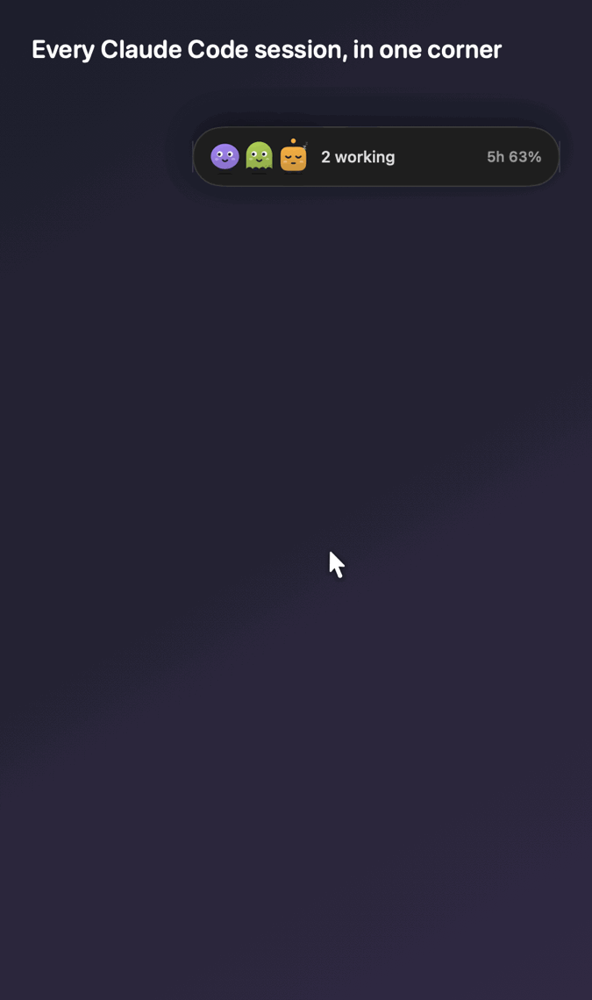
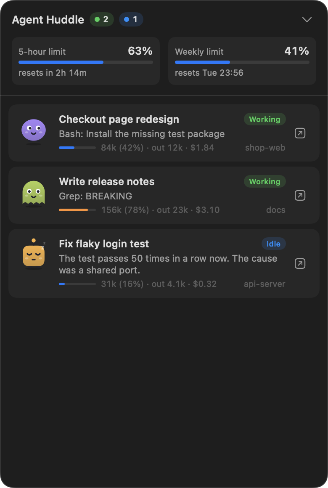
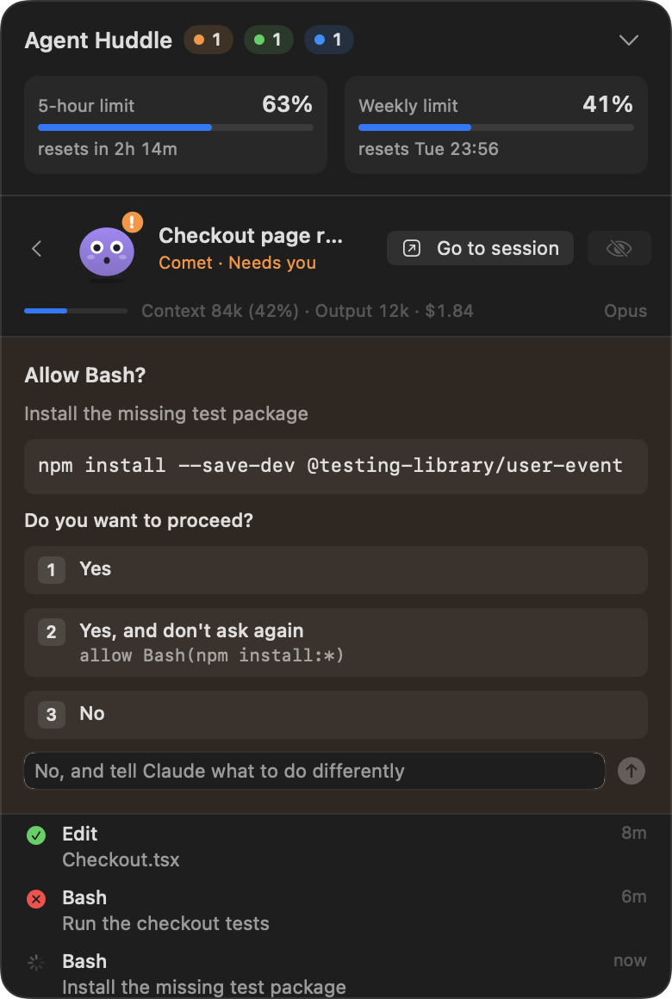
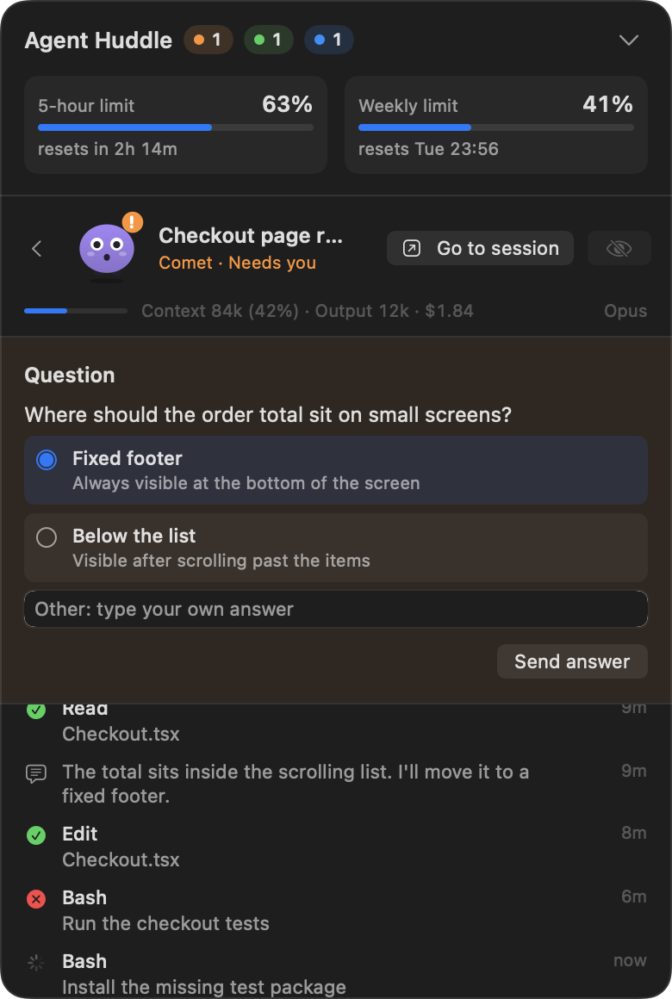

# Agent Huddle

 

Agent Huddle is a small macOS widget that keeps every Claude Code session you have running in one corner of your screen. See what each agent is doing, answer its permission requests and questions without switching windows, and watch how much of your usage limits is left. Each session gets its own little buddy that shows its mood: working, waiting, or in need of you.



*The demo uses sample data. Record it again with `HUDDLE_RECORD=docs/demo.gif .build/debug/AgentHuddle`.*

## Get started

You need macOS 14 or later, the Swift toolchain (`xcode-select --install`) and Claude Code.

1. Get the code and install:

    ```sh
    git clone https://github.com/kengboonang/agent-huddle.git
    cd agent-huddle
    ./install.sh
    ```

2. Look in the bottom-right corner of your screen for the pill, and click it.

3. Start a new Claude Code session. Sessions that were already open need a restart to use the new hooks.

To remove everything except your handoff documents and evidence logs, run `./uninstall.sh`.

## What it does

| All sessions | A request | A question |
|---|---|---|
|  |  |  |

- **A buddy for each session.** Every session gets its own small character, always the same one for
  that session. It bobs while the session works, hops with a "!" when the session needs you, and
  sleeps when the session is idle.
- **All sessions in one list.** Each row shows the session name, its folder, what it is doing now,
  how full its context window is, the output tokens so far and the cost.
- **Usage limits.** Your 5-hour and weekly limits, with the percent used and when each one resets.
- **Step by step.** Click a session to see its prompts, tool calls (running, done or failed) and replies.
- **Decide permissions with a click.** The request card works like Claude Code's own prompt:
  "Yes", "Yes, and don't ask again", "No", or "No, and tell Claude what to do differently".
  Plans are approved the same way.
- **Answer questions.** Pick one or several of the options Claude offers, or type your own answer.
- **Answer from the list.** A session that needs you moves to the top and shows the exact command or
  path. Allow and Deny are on the row when the whole request fits there; a longer one opens in detail.
  The buttons switch off for a moment whenever the request on screen changes, so a click cannot land
  on a request you have not read.
- **Go to the session.** The arrow on every row brings the window where that session runs to the
  front. In Terminal and iTerm it selects the tab; in VS Code, Cursor and Windsurf it brings up the
  window that has the session's folder open.
- **It tells you when you are needed.** The widget opens on the session and plays a sound. It plays a
  different sound when a session finishes working.

The widget sits in the bottom-right corner as a small pill. Click the pill to open it. Drag the open
panel by its background to move it. The menu bar icon shows or hides the widget and quits it.

## What the installer changes

`./install.sh` (add `--no-login-item` to not start the widget at login):

1. Builds the app and puts it in `~/Applications/Agent Huddle.app`.
2. Copies four scripts to `~/.claude/huddle/bin/`.
3. Changes `~/.claude/settings.json` (a dated backup is saved next to it):
   - a `PermissionRequest` hook, so requests reach the widget;
   - a status line, which is how Claude Code hands over limits, context percent and cost;
   - `Stop`, `PreCompact` and `SessionStart` hooks for handoff documents;
   - `PostToolUse` and `Stop` hooks for the evidence log;
   - permission rules: sessions may read and write `~/claude-handoffs`, and may not edit `~/.claude/huddle`.
4. Adds a login item, so the widget starts when you log in.

Run `./install.sh` again after you change the code.

## How it works

```
~/.claude/sessions/*.json ─────────────┐  which sessions are running, and busy or idle
~/.claude/projects/**/<session>.jsonl ─┤  steps and token counts (the transcript)
~/.claude/huddle/status/<session>.json ┤  limits, context percent, cost (saved by the status line)
                                       ▼
                                 Agent Huddle
                                       ▲ │
     ~/.claude/huddle/pending/<id>.json│ │~/.claude/huddle/responses/<id>.json
                                       │ ▼
                          PermissionRequest hook ◀──▶ Claude Code
```

- The hook waits only while the widget runs. The widget updates a heartbeat file every second; when
  the file is older than 6 seconds, the hook prints nothing and Claude Code asks in the session as usual.
- The request also shows in the session. Answer in either place: the other one clears itself.
- Nothing leaves your Mac. The app makes no network calls.

## Limits you should know

- **Usage limits come from the status line**, which Claude Code runs only in terminal sessions and only
  after the first reply. Sessions started from the Claude desktop app still appear, with token counts
  from their transcripts, but without a context percent or cost.
- **Limits are as fresh as the last terminal reply.** With no terminal session active, the numbers do
  not move.
- **You cannot type a new prompt from the widget.** Claude Code has no documented way to send one to a
  running session. Use the arrow to go to the session.
- **Going to a session in a VS Code-style editor opens the session's folder.** If that folder is not
  already open in a window, the editor opens a new window for it. In other apps the app comes to the
  front, but not a particular window.
- **A session can still approve itself through the shell.** The deny rule stops Claude's file tools from
  writing answers into `~/.claude/huddle`, but a Bash command you have already allowed could. Keep
  broad Bash allow rules out of your settings.

## Automatic handoff documents

`hooks/handoff.py` makes sure the state of a session is written down before its context is compacted.

| When | What happens |
|---|---|
| A turn ends with the context 70% full | Claude is asked to write `handoff.md`: goal, current state, decisions, key files and commands, what failed, next steps, open questions |
| A turn ends with the context 80% full | Claude is asked to bring `handoff.md` up to date |
| Just before any compaction | A script saves `snapshot.md` from the transcript (your requests, the task list, edited files, failed commands, Claude's last messages, git status) and tells the summary what to keep |
| Right after a compaction | Both documents are given back to Claude |
| A new session starts in the same folder | Claude is told where the latest notes are (not shown the notes), if they are less than 7 days old |

Documents are kept in `~/claude-handoffs/<folder>/<session id>/`.

The snapshot needs no model, so it is written every time, even when Claude never wrote a handoff.
It records what happened but not why; the reasons are in `handoff.md`.

Settings, as environment variables: `HANDOFF_THRESHOLD` (70), `HANDOFF_UPDATE_THRESHOLD` (80),
`HANDOFF_CONTEXT_WINDOW` (200000, used only when the status line has not reported the real size),
`HANDOFF_DIR` (`~/claude-handoffs`).

## Evidence log for web searches

`hooks/evidence.py` lets you check what Claude really searched and read.

| When | What happens |
|---|---|
| After every web search or page read | The query or address, the result links, and exactly what came back to Claude are added to `evidence.md` |
| A turn ends | You see one line: how many searches and pages, and a link to the file |
| A turn ends with links in the answer | Each link is compared with everything searched, fetched, read or typed in the session. Links found nowhere are listed for you as "Not checked", and Claude is asked once to check or remove them |

Files are kept in `~/claude-evidence/<folder>/<session id>/`. The widget shows a "Sources" link on a
session that has a log.

What it cannot do:

- A page read gives Claude a summary made by a small model, not the page. The log shows that summary;
  open the address to see the page itself.
- It checks that a link was seen, not that the answer describes the page correctly.
- A link Claude builds from parts (for example a GitHub address from an owner and a name) is reported
  as not checked, even when it is right.

Set `EVIDENCE_NUDGE=0` to only report unchecked links and not ask Claude to fix them.

## Tests

```sh
./scripts/test.sh
```

Runs the Swift unit tests (transcript reading, token and reset formatting, limits, decisions) and the
Python tests (the permission hook against a simulated widget, the status line, the handoff hook, and
the settings installer).

Check the layout without touching real sessions:

```sh
swift build
HUDDLE_DEMO=permission HUDDLE_SNAPSHOT=/tmp/huddle.png .build/debug/AgentHuddle   # list, needs, detail, permission, question, pill
HUDDLE_SNAPSHOT=/tmp/live.png .build/debug/AgentHuddle                            # your real sessions
```

## Layout of the code

| Path | What it holds |
|---|---|
| `Sources/HuddleCore` | Reading sessions, transcripts and limits; formatting; building decisions. No UI, fully tested |
| `Sources/AgentHuddle` | The widget: store, views, request cards, window, "Open" |
| `hooks/huddle_hook.py` | The permission hook |
| `hooks/huddle_statusline.py` | The status line |
| `hooks/handoff.py` | The handoff hook |
| `hooks/evidence.py` | The evidence log hook |
| `scripts/settings.py` | Adds and removes the settings entries |

## License and credit

[MIT](LICENSE).

The idea comes from a demo of a widget with the same name by Alex Tsoi
([reel](https://www.instagram.com/reel/DfpiIzDHDnA/)). This is a separate implementation written
from scratch; it shares no code with that project.
